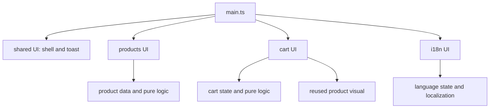

# ShopBoard Agent Instructions

**Before making changes, inspect the relevant existing modules and reuse their functions. Never duplicate existing logic or introduce competing sources of truth. Preserve existing public behavior, data formats, event handling, and application functionality.**

## Stack

- Vite, vanilla TypeScript ES Modules, HTML5, and CSS3.
- Keep console exercises outside the application unchanged.

## Five Rules

1. Use semantic HTML elements.
2. Every input must have a label.
3. Follow mobile-first design using `min-width` media queries.
4. Do not use `!important` in CSS.
5. Explain every code change.

## Feature-Based TypeScript Module Architecture

### Preserve the current architecture

- Keep the existing project structure exactly as documented below. Do not rename, move, merge, or delete existing files, or refactor existing modules.
- Preserve all existing functionality, design, product data, translations, and storage keys. Follow existing conventions when modifying current features; the simpler structure for new features does not authorize restructuring existing ones.

The actual source structure is:

```text
src/
  assets/                         Existing image and SVG assets
  shared/
    storage.types.ts              Storage interface used by both persistence stores
    ui/
      dom.ts                      Typed DOM creation, lookup, and replacement helpers
      icons.ts                    Existing outline icons and inline brand symbol
      formatting.ts               UI adapters reading the current language preference
      storefront.ts               Page shell, decorative icons, campaign fallback
      toast.ts                    Existing notification, timer, and translation refresh
  modules/
    products/
      products.types.ts           Product, Category, Language, and translation types
      products.data.ts            The unchanged local 12-product catalog
      products.logic.ts           Pure search, category, sort, and selection functions
      products.ui.ts              Cards, shared product visual, controls, navigation
    cart/
      cart.types.ts               Product-ID-to-quantity cart types
      cart.state.ts               Cart loading, validation, updates, and saving
      cart.logic.ts               Pure item count and subtotal calculations
      cart.ui.ts                  Cart DOM, quantity controls, dialog, and checkout
    i18n/
      i18n.ts                     Unchanged messages, locales, and pure formatters
      i18n.state.ts               Language preference and localStorage persistence
      i18n.ui.ts                  Language switcher and document/interface translations
  main.ts                         Mount once, initialize controllers, connect callbacks
  style.css                       Existing responsive styling
```

### Default structure for new features

Before implementing a new feature, inspect the existing architecture, relevant modules, and shared utilities. Use this simple structure under `src/` by default:

```text
modules/
  <feature>/
    <feature>.types.ts
    <feature>.logic.ts
```

- `<feature>.types.ts` contains the feature's TypeScript types and interfaces.
- `<feature>.logic.ts` contains its business logic and functions, independent of DOM manipulation and browser storage.
- Create additional files such as `.ui.ts`, `.state.ts`, or `.data.ts` only when genuinely necessary. Keep small features simple; do not create speculative files or unnecessary abstractions.

### Responsibilities and dependencies

- Follow the Single Responsibility Principle: each module has one clear job. Keep code clean, readable, reusable, and maintainable. The catalog is local: do not invent API clients, endpoints, or backend dependencies.
- Put genuinely reusable helpers in `shared/`. Product-specific image rendering stays in `products.ui.ts` and is reused by `cart.ui.ts`; do not copy it into the cart. Common DOM helpers, icons, UI localization adapters, and the existing toast each have one implementation.
- Keep DOM access in `*.ui.ts` or `shared/ui/`. Never access the DOM in data, type, pure logic, or state files. Keep direct localStorage access in state/persistence modules; the current implementation has two `*.state.ts` stores.
- Pure logic accepts inputs and returns results without modifying its input arrays or objects. Never duplicate totals or filtering calculations in UI code.
- Use named imports and exports. Use `import type` and `export type` for type-only dependencies. Keep imports explicit and resolvable by Vite and the Node tests.
- Avoid circular imports, including type dependency cycles. `main.ts` connects cross-feature UI callbacks; products UI must not import cart UI. `cart.ui.ts` may reuse the exported product visual. Shared UI formatting may read the language store, but pure localization and persistence must never import UI code.
- Keep a single catalog, cart store, language store, and toast controller. Mount the shell and register listeners once. Language refreshes update content; they never remount the page or register listeners.
- Keep functions small and readable. Extract a helper only when it has a clear responsibility or is actually reused; do not rewrite working algorithms just to change their location.



`main.ts` passes the cart's add-item callback to products UI and refreshes products, cart, toast, and campaign fallback after language changes.

### TypeScript and safe development

- Maintain `strict: true`, `noEmit: true`, and `noUnusedLocals: true`. Never use `any`, type assertions (`as`, including `as const` and angle-bracket assertions), non-null assertions (`!`), error suppression comments such as `@ts-ignore`, `@ts-nocheck`, or `@ts-expect-error`, or compiler changes to hide errors. Use proper types, validation, and type narrowing instead. Existing code is not to be refactored merely to enforce this rule retroactively.
- Use accurate types for parameters, returns, data, DOM nodes, and events. Check nullable elements and narrow event targets before using element methods. Treat parsed storage data as `unknown` until validated.
- Before changes, inspect callers, exports, listeners, tests, and current behavior. Make only necessary changes within the current architecture, reuse existing functions and shared utilities, and avoid duplicate code or competing sources of truth. Do not introduce breaking changes.
- Preserve all product IDs, names, prices, categories, image paths, descriptions, and translations. Category is the union of actual supported values. Never invent product fields. Keep English, Arabic, Turkish, translation keys, USD values, and RTL/LTR behavior unchanged.
- Keep cart storage key `shopboard-catalog-cart-v2` and its object format mapping product ID strings to numeric quantities. Keep language key `shopboard-language`. Validate quantities, ignore unknown IDs, and tolerate corrupt or blocked storage. Return cart copies rather than exposing internal state. Never reset saved carts during refactors.
- Do not redesign, change branding, or modify unrelated content, styles, assets, or functionality during development. Stop and explain if preserving existing behavior becomes impossible.
- After code changes, run `npm run typecheck`, `node --test tests/*.test.js`, and `npm run build`. Preserve existing tests without weakening assertions and add focused regression tests when needed. Inspect the exact running URL when browser testing is available; verify languages, persistence, combined controls, cart, and responsive behavior.
- Do not commit or push without explicit user permission.

## Feature rules

- Search uses the input event and matches current-language product names without case sensitivity, including Turkish case folding and Arabic normalization.
- Category and price dropdowns use change events; all three controls call the same product render function.
- Filter first, then sort a copy. Never sort the original catalog in place. Preserve Default order and the under-$50 navigation filter.
- Generate category choices from the product data and preserve the selected category during translation.
- Keep cart add, remove, quantities, persistence, totals, free-shipping messaging, clear confirmation, focus restoration, and demo checkout working.
- Preserve language selection, image fallbacks, notification translations, accessible labels, and existing navigation.
