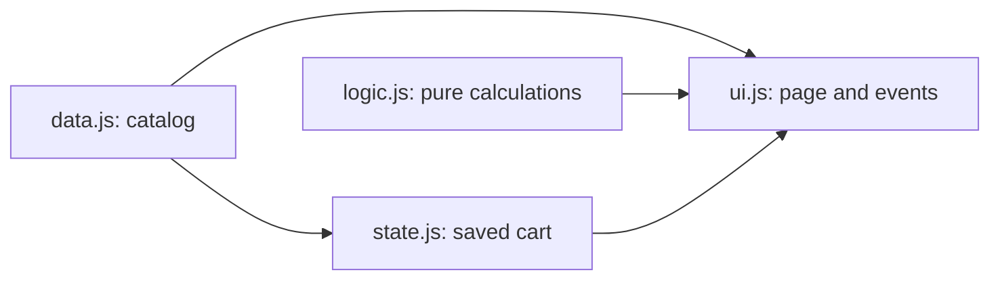

# ShopBoard Agent Instructions

## Stack

- Vite (Vanilla JavaScript)
- HTML5
- CSS3
- JavaScript

## Five Rules

1. Use semantic HTML elements.
2. Every input must have a label.
3. Follow mobile-first design using `min-width` media queries.
4. Do not use `!important` in CSS.
5. Explain every code change.

## Four parts

- `src/data.js`: product data only. Keep the catalog here as exported data; do not add DOM, storage, or behavior.
- `src/logic.js`: pure functions for name search, category filtering, price sorting, category extraction, formatting, and cart totals. Return results without modifying input arrays or objects. Never access the DOM or localStorage here.
- `src/state.js`: owns cart quantities and localStorage loading/saving. Validate saved quantities, ignore unknown product IDs, and keep the cart usable when storage fails. Return cart copies rather than exposing internal state. Never access the DOM here.
- `src/ui.js`: owns all DOM creation, rendering, and browser event handlers. Read controls, call logic functions, change the cart through state functions, and render the results. Never read or write localStorage directly or duplicate business calculations here.

`src/main.js` is only the Vite bootstrap: import styles and the UI. CSS remains in `src/style.css`. Keep console exercises outside the application unchanged.

## Data flow

Arrows show a module providing data or functions to another module.

## Feature rules

- Search uses the input event and matches product names without case sensitivity.
- Category and price dropdowns use change events; all three controls call the same product render function.
- Filter first, then sort a copy. Never sort the original catalog in place.
- Generate category choices from the product data.
- Keep cart add, remove, quantities, persistence, totals, free-shipping messaging, and the demo checkout working.
- Keep the existing storage key `shopboard-catalog-cart-v2` so saved bags survive refactors.
- Run `npm run build` after changes and verify affected logic and state behavior.
